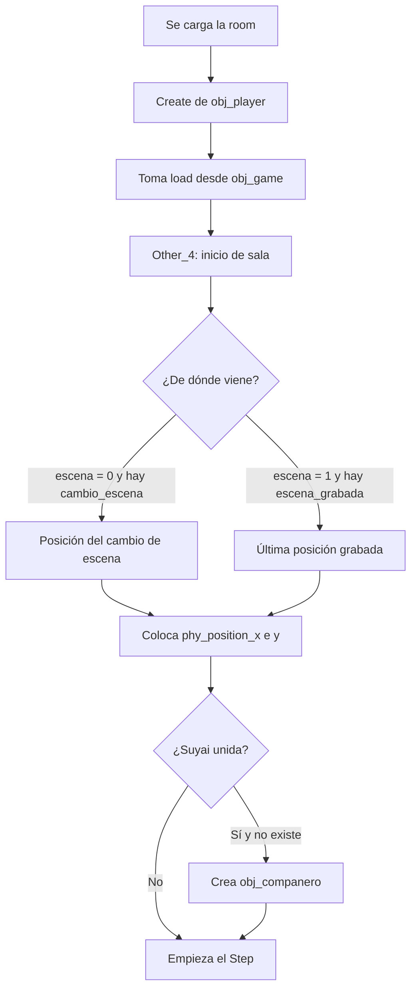
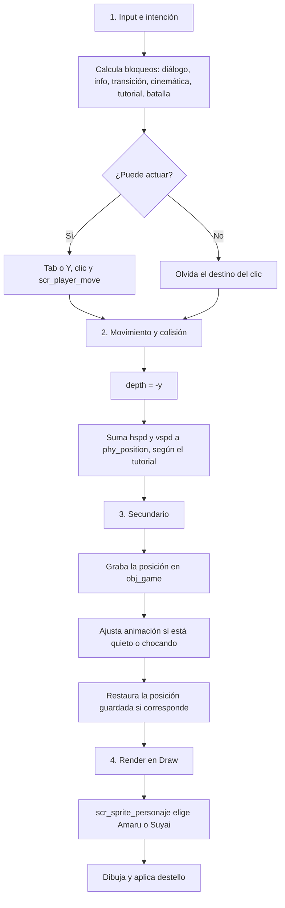
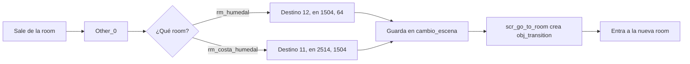

# Ejemplo: `obj_player` con Feature Cascade

Este documento es una **propuesta**: todavía no se aplicó nada. Muestra cómo quedaría `obj_player` con grupos limpios y el pipeline de `.claude/rules/gamemaker.md`, sin mover archivos físicos ni cambiar cómo funciona el juego.

## 1. Idea general

| Qué | Cómo queda |
|---|---|
| **Archivos en disco** | Igual que hoy: `objects/obj_player/`, `scripts/scr_player_move/`, `rooms/rm_humedal/` |
| **Rutas del `.yyp`** | Sin cambios |
| **Grupos en GameMaker** | Por feature y responsabilidad, sin carpetas `Scripts` ni `Objects` |
| **Código** | `Step` ordenado como pipeline y `Draw` para dibujar |
| **Nombres de funciones y variables** | Sin cambios, porque 95 archivos GML nombran a `obj_player` |

## 2. Cómo está hoy

Lo que pertenece al jugador está repartido en varios grupos:

| Recurso | Grupo actual | Problema |
|---|---|---|
| `obj_player` | `00_Core` | Separado de los scripts que lo mueven |
| `scr_player_move` | `99_Sin_Uso_Revisar/Scripts` | **Está mal clasificado:** es el movimiento real (`state = scr_player_move`) |
| `scr_amaru_clic`, `scr_cambiar_personaje`, `scr_sprite_personaje`, `scr_cargar_posicion` | `08_Jugador_CambioZona/Scripts` | Mezclados con scripts de enemigos |
| `obj_companero` | `08_Jugador_CambioZona/Objects` | Separado de `scr_cambiar_personaje` |
| `scr_go_to_room` | `02_Nucleo_Partida/Scripts` | Bien ubicado: lo usan otras features |
| `spr_amaru_walk_rightDown` | `Sprites/00_Core` | Sprite del jugador en un grupo general |

Eventos de `obj_player`:

| Evento | Líneas | Qué hace |
|---|---|---|
| `Create_0` | 31 | Inicializa velocidad, clic, choque y carga |
| `Step_0` | 104 | Mezcla bloqueos, input, movimiento, historial, animación y carga |
| `Draw_0` | 11 | Dibuja el personaje activo y el destello. **Ya cumple la regla** |
| `Other_0` (salir de la sala) | 20 | Pasa entre `rm_humedal` y `rm_costa_humedal` |
| `Other_4` (inicio de sala) | 19 | Coloca al jugador y crea a Suyai si corresponde |
| `Collision_obj_npc`, `Collision_obj_zone` | 0 | Vacíos |

## 3. Grupos propuestos

```text
02_Jugador/
├── Controlador/
│   └── obj_player
├── Pipeline/
│   └── scr_player_pipeline      (nuevo: pasos del Step)
├── Input/
│   └── scr_amaru_clic
├── Movimiento/
│   └── scr_player_move
├── Personajes/
│   ├── obj_companero
│   ├── scr_cambiar_personaje
│   └── scr_sprite_personaje
└── Posicion/
    └── scr_cargar_posicion

Sprites/
└── Personajes/
    ├── Amaru/                   (spr_amaru_stand_*, spr_amaru_walk_*)
    └── Suyai/                   (spr_suyai_walk_* y los demás del mapa)
```

Decisiones de este ejemplo:

- **`obj_player` sale de `00_Core`:** es muy usado, pero su responsabilidad es ser el jugador. `00_Core` quedaría para lo que no tiene dueño. Esto cambia lo que sugiere la estructura anterior y requiere tu aprobación.
- **`scr_go_to_room` y `obj_transition` van a `01_Partida/Transiciones`:** los usan otras features.
- **`scr_movimiento` va a `03_Batalla`:** su único uso es `obj_player_battle`, a pesar del nombre.
- **`obj_player_battle` queda en `03_Batalla`:** es otro objeto, con otro comportamiento.
- **Sprites de batalla de Amaru van a `03_Batalla`:** `spr_amaru_battle_*` no pertenecen al mapa.

## 4. Rooms

Las rooms no son del jugador: el jugador aparece en ellas. Por eso se agrupan por zona, y las rooms de una feature propia quedan con esa feature.

```text
07_Mundo/
└── Zonas/
    ├── Anzota/      rm_anzota, rm_anzota_2, rm_anzota_3, rm_cuevas_anzota
    ├── Humedal/     rm_humedal, rm_costa_humedal
    ├── Camarones/   rm_camarones
    ├── Capilla/     rm_capilla
    └── Morro/       rm_final_morro, rm_final_demo
06_Momia/
└── Escena/          rm_Momia, rm_momificar
08_NPCs_Dialogos/
└── Tutorial/        rm_tutorial, rm_tutorial_test
03_Batalla/
└── Escena/          rm_battle, rm_battle_tutorial
09_UI/
└── Menu/            rm_menu
```

`obj_player` está colocado en 12 rooms: `rm_anzota`, `rm_anzota_2`, `rm_anzota_3`, `rm_camarones`, `rm_capilla`, `rm_costa_humedal`, `rm_cuevas_anzota`, `rm_final_morro`, `rm_humedal`, `rm_momificar`, `rm_tutorial` y `rm_tutorial_test`. No está en `rm_menu`, `rm_Momia`, `rm_battle`, `rm_battle_tutorial` ni `rm_final_demo`.

> **Importante: no cambiar el orden de las rooms.** Mover una room de grupo es seguro, pero reordenar la lista de rooms no. `Other_0` usa números: `11` es `rm_humedal` y `12` es `rm_costa_humedal`. Si cambia el orden, el jugador llega a otra sala.

## 5. Flujo completo

### Al entrar a una sala



### En cada frame



### Al salir de una sala



## 6. `Step_0` antes y después

El orden actual ya se parece a la cascada, pero está todo junto en 104 líneas. Se separa sin reordenar nada:

| Paso | Bloque de código actual | Función propuesta |
|---|---|---|
| Medición inicial | `avance`, `choque_x`, `choque_y` | Queda en el `Step` |
| 1. Input e intención | Bloqueos, Tab, clic, `script_execute(state)` | `scr_player_intencion()` |
| 2. Movimiento y colisión | `depth = -y`, suma a `phy_position_*` | `scr_player_mover()` |
| 3. Secundario | `array_item`, `escena_grabada` | `scr_player_grabar_posicion()` |
| 3. Secundario | `choque_frames`, sprite quieto | `scr_player_animar(avance)` |
| 3. Secundario | `load`, `scr_cargar_posicion` | `scr_player_aplicar_carga()` |
| 4. Render | `Draw_0` | Sin cambios |

Así quedaría `objects/obj_player/Step_0.gml`:

```gml
// Avance real desde el Step anterior, con la física ya resuelta
var avance = point_distance(x, y, choque_x, choque_y);
choque_x = x;
choque_y = y;

scr_player_intencion();          // 1. Input e intención
scr_player_mover();              // 2. Movimiento y colisión
scr_player_grabar_posicion();    // 3. Secundario
scr_player_animar(avance);
scr_player_aplicar_carga();
// 4. Render: evento Draw
```

Y `scr_player_pipeline` tendría funciones como esta, con el código copiado tal cual:

```gml
// Pasos del Step de obj_player: corren en su contexto y usan sus variables
function scr_player_mover() {
    depth = -y;

    if (instance_exists(obj_control_tutorial))
    {
        if (obj_control_tutorial.paso > 2 || !obj_control_tutorial.tutorialOn)
        {
            phy_position_x += hspd;
            phy_position_y += vspd;
            enable_player = 0;
        }
        else
        {
            enable_player = 1;
        }
    }
    else
    {
        phy_position_x += hspd;
        phy_position_y += vspd;
    }
}
```

Se crea un solo script con varias funciones, en vez de cinco recursos con sus `.yy`. Las funciones se usan solo desde `obj_player`.

## 7. Qué no cambiaría, y por qué

| Tema | Decisión | Motivo |
|---|---|---|
| `hspd`/`vspd` | No renombrar a `hsp`/`vsp` | Otros archivos les asignan valores directamente (15 veces cada una) |
| `enable_player` | No tocarlo por ahora | Se asigna desde fuera 17 veces. Conviene una función propia en otro cambio |
| Eventos de colisión vacíos | No borrarlos | Es un objeto con física; un evento vacío puede ser lo que activa el choque. Hay que probarlo antes |
| Variables de clic y choque | No pasarlas todavía a un constructor | Nombres como `tramo` o `destino_activo` aparecen también en otros objetos y scripts. Falta confirmar si son los mismos datos |
| Mappers | No crearlos | La regla los prohíbe, y `scr_sprite_personaje` es una función simple |
| `Draw_0` | Sin cambios | Ya cumple la regla |

**Posible constructor futuro:** `PlayerDestinoClic`, con `activo`, `x`, `y`, `objetivo`, `tramo` y el atasco, cuando se confirme lo anterior. Aplicarlo cambia `scr_player_move` y `scr_amaru_clic`, así que sería su propio paso.

## 8. Otros hallazgos, para corregir aparte

- `k_dow` en `Create_0` es una errata de `k_down` y no se usa en ningún lado.
- `scr_player_move` mezcla input, velocidad y animación. Se puede separar después, ya con el pipeline funcionando.
- Los números de room en `Other_0` deberían ser `rm_costa_humedal` y `rm_humedal`. Esa corrección quitaría el riesgo de la sección 4.

## 9. Pasos para aplicarlo

1. **Grupos:** mover los recursos a los grupos nuevos, cambiando solo `parent` en sus `.yy` y `Folders` en el `.yyp`. Verificar con `gm_project_check`.
2. **Prueba:** abrir en GameMaker y comprobar que todo sigue igual.
3. **Pipeline:** crear `scr_player_pipeline` en `02_Jugador/Pipeline`, mover los bloques y dejar el `Step` corto. Revisar en el diff que el código sea el mismo.
4. **Linter:** ejecutar `python3 tools/gml_linter.py` sobre el script y sobre `objects/obj_player`.
5. **Prueba final:** repetir la lista de abajo.

## 10. Lista de prueba en GameMaker

- [ ] Moverse con teclado, WASD, stick y clic, incluido el clic sobre algo interactivo.
- [ ] Chocar contra una pared: Amaru queda quieto y sin animación de caminar.
- [ ] Diálogos, carteles de info y cinemáticas bloquean y luego devuelven el control.
- [ ] Pasos 1 y 2 del tutorial: el jugador no puede moverse hasta que aparece Wanku.
- [ ] Cambiar de personaje con Tab o Y, y ver el destello.
- [ ] Ir y volver entre `rm_humedal` y `rm_costa_humedal`: aparece en el lugar correcto.
- [ ] Con Suyai unida, ella aparece en cada sala.
- [ ] Entrar y salir de una batalla: el jugador vuelve a su posición.
- [ ] Cargar una partida guardada: aparece en la posición guardada.

## 11. Decisiones pendientes

1. ¿`obj_player` pasa a `02_Jugador/Controlador` o se queda en `00_Core`?
2. ¿Los sprites también se reorganizan ahora, o después del código?
3. ¿Corregimos los números de room de `Other_0` en este cambio o en uno propio?
